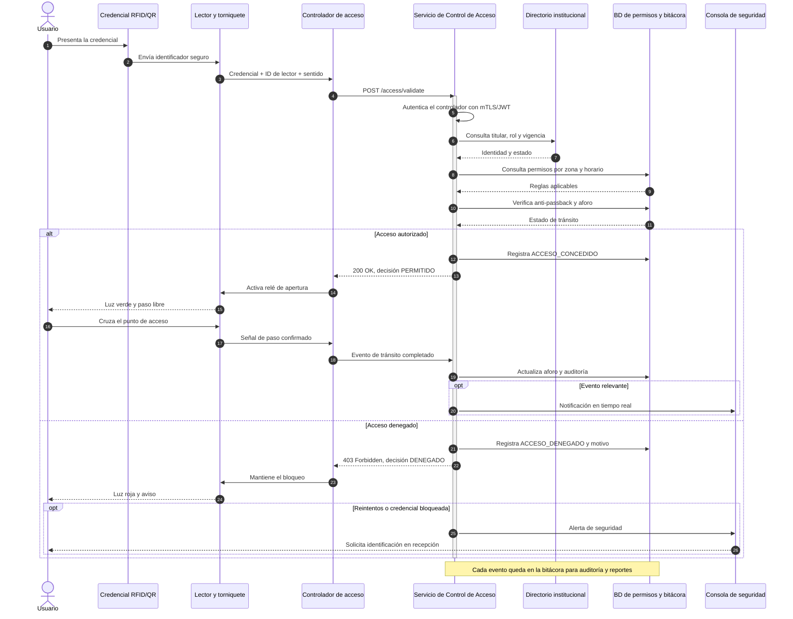
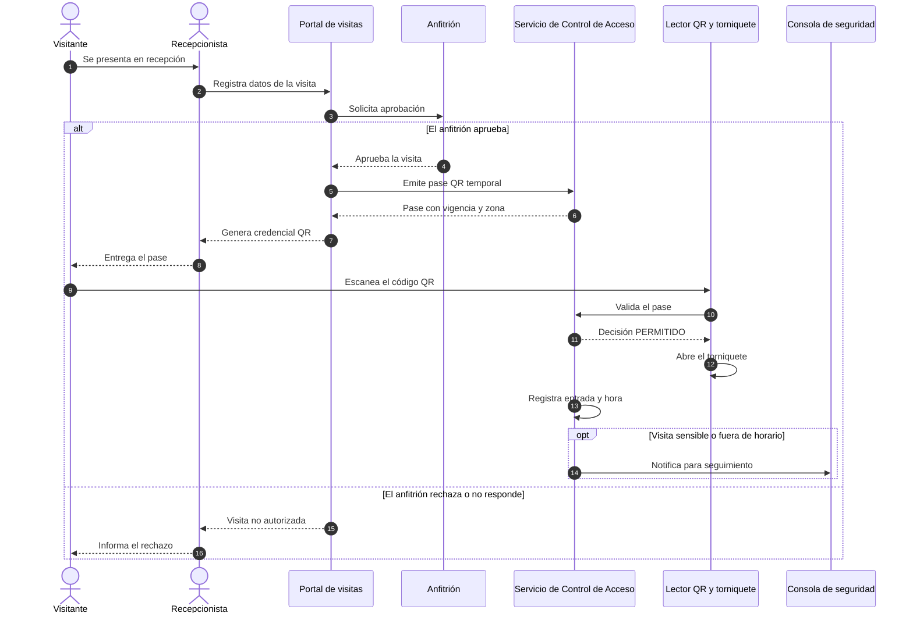

# Sistema de control de acceso universitario

Diagramas de secuencia del flujo principal de acceso y del registro de visitantes.

## 1. Acceso de estudiantes, docentes y personal

### Participantes

| Participante | Responsabilidad |
|---|---|
| Usuario | Estudiante, docente o personal que solicita el acceso. |
| Credencial | Tarjeta RFID, código QR o dato biométrico. |
| Lector y torniquete | Lee la credencial, muestra el resultado y controla el paso físico. |
| Controlador de acceso | Dispositivo local que envía la solicitud y acciona el relé. |
| Servicio de Control de Acceso | Valida la solicitud, aplica reglas y toma la decisión. |
| Directorio institucional | Identidad, rol, vigencia y estado del usuario. |
| BD de permisos y bitácora | Zonas autorizadas, horarios, anti-passback, aforo y auditoría. |
| Consola de seguridad | Recibe alertas y atiende incidencias. |

### Reglas que se validan

- Credencial vigente y no bloqueada.
- Usuario activo y con rol habilitado.
- Permiso para la zona o edificio solicitado.
- Horario permitido según el rol.
- Anti-passback: no reutilizar la misma entrada sin haber salido.
- Aforo máximo de la zona.
- Autenticidad del controlador mediante mTLS o JWT.

## 2. Acceso de visitantes

## Notas de diseño

- **Tolerancia offline:** el controlador puede validar credenciales cacheadas y registrar eventos localmente si se pierde la conexión; luego los sincroniza.
- **Idempotencia:** cada evento lleva un identificador único para evitar duplicados al reintentar.
- **Seguridad:** comunicación cifrada, credenciales no almacenadas en claro y registro inmutable de eventos.
- **Privacidad:** solo se guardan los datos necesarios y se aplican políticas de retención.
- **Disponibilidad:** el servicio debe responder en menos de un segundo para no generar filas en los accesos.
